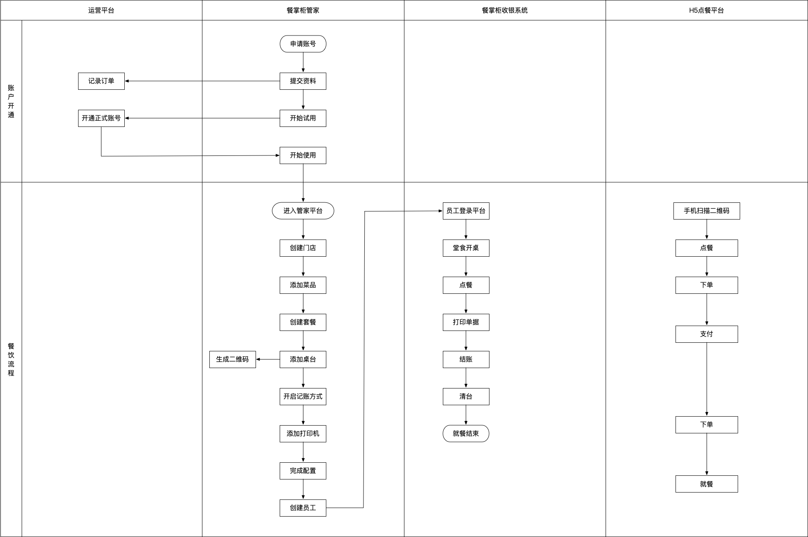
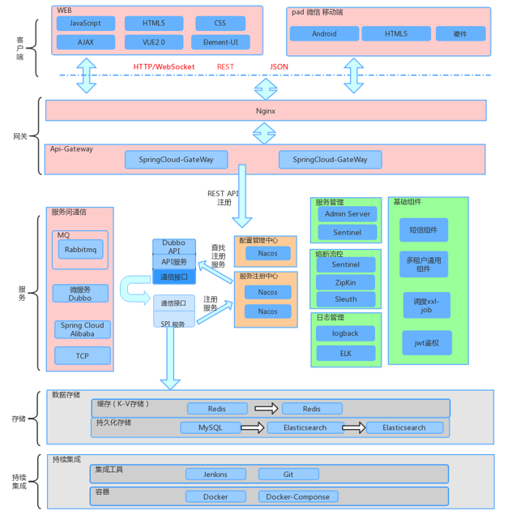
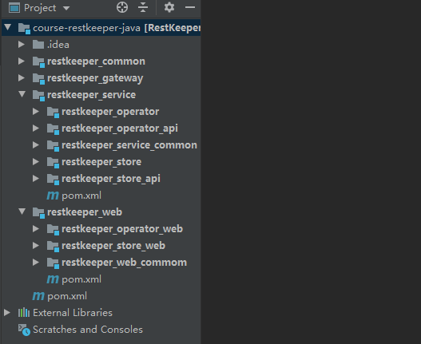
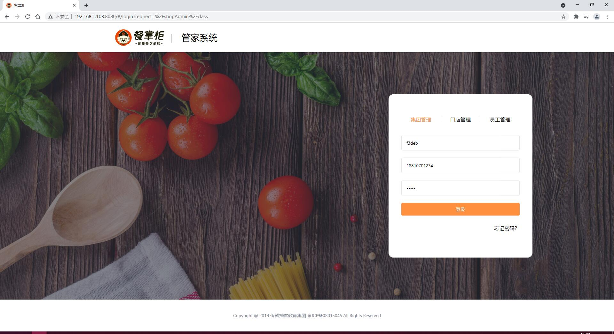
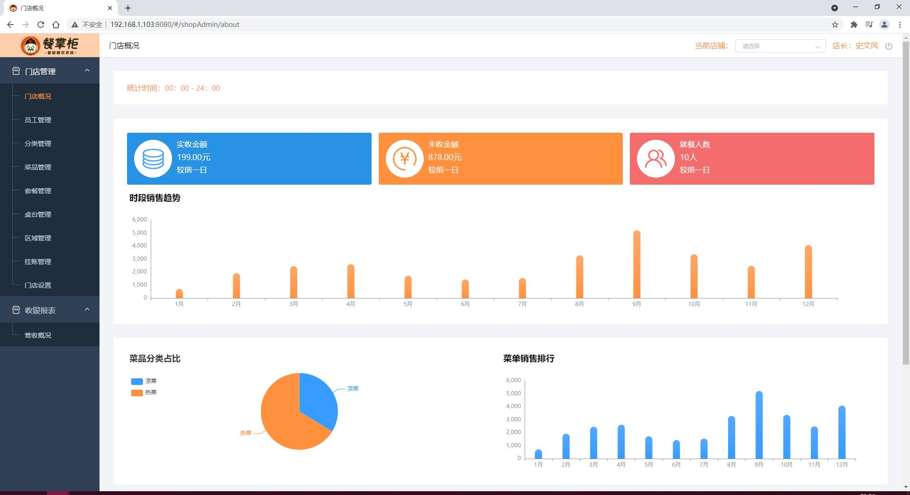
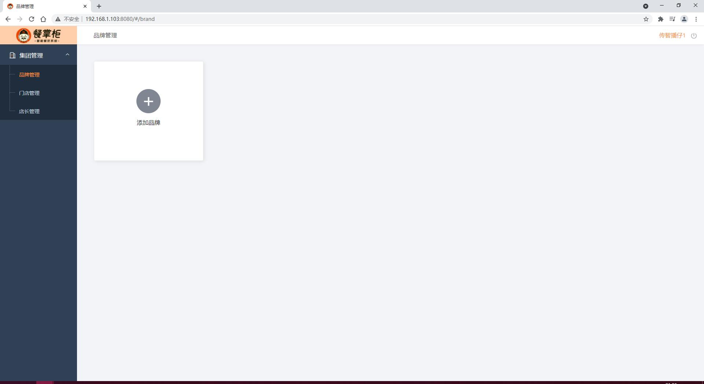
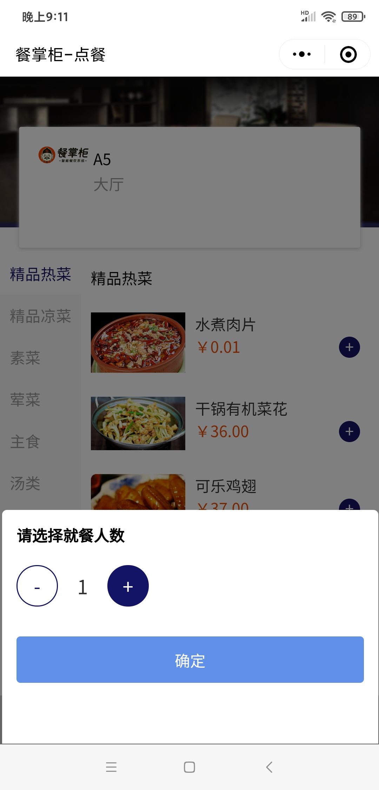
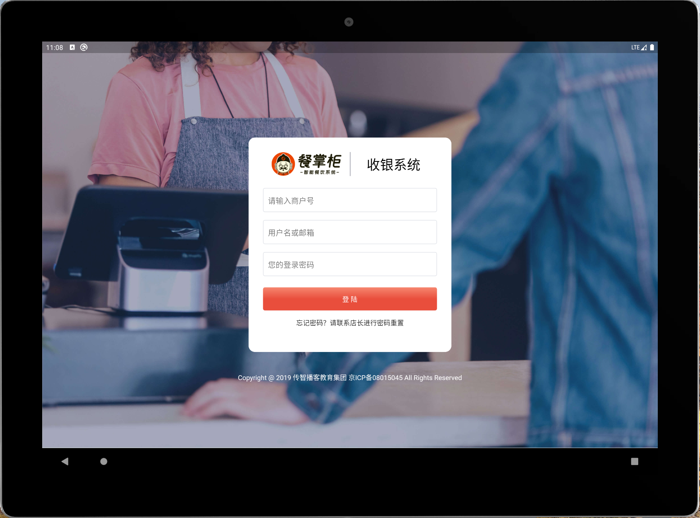
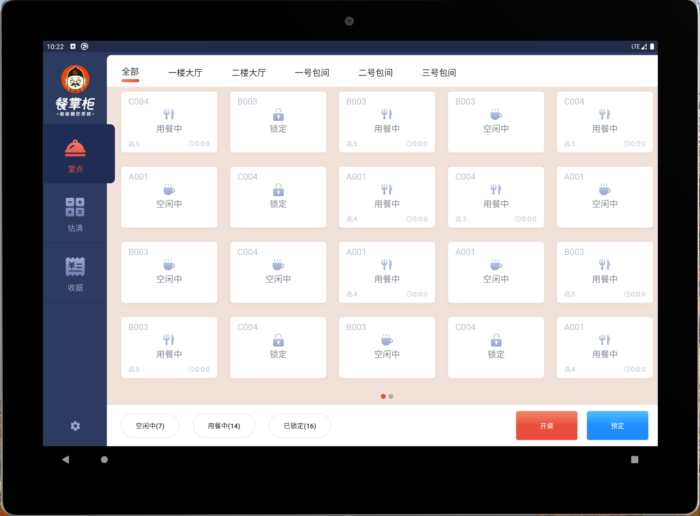

> 本仓库为个人学习归档，代码著作权归原作者／原课程机构所有。本仓库不授予任何许可，请勿用于商业用途。

<h1 align="center">心飞餐饮 · XinFei Dining</h1>

<h4 align="center">餐饮 SaaS 的四个子系统 —— 运营中心、商家管家、收银、扫码点餐</h4>

  
  
  
  

  
  
  
  
  
  
  
  

  <a href="#一这是什么">这是什么</a> ·
  <a href="#二四个子系统">子系统</a> ·
  <a href="#三业务流程">流程</a> ·
  <a href="#四技术架构">架构</a> ·
  <a href="#六部署说明">部署</a> ·
  <a href="#八版权说明">版权</a>

---

## 一、这是什么

「餐掌柜」课程项目的整理版，一套面向餐饮行业的管理系统：从商家入驻、门店配置，到开桌点餐、结账清台，全流程跑得通。

先把版本说清楚：后端是 Spring Boot 2.1.6 + Spring Cloud Greenwich.SR2，这是 2019 年前后的技术栈，不是当前主流版本。代码质量、依赖版本、构建方式都停留在那个年代，拿它当学习材料可以，当生产底座不行。

前端四个工程在 [xfcy-ui](https://gitee.com/itxinfei/xfcy-ui)。

## 二、四个子系统

| 子系统 | 谁在用 | 干什么 |
|---|---|---|
| 平台运营中心 | 平台运营方 | 账号开通、订单中心、平台配置、支付中心 |
| 商家管家 | 商家店长／集团管理员 | 桌台区域、菜品分类、员工与权限、统计分析，支持集团多店 |
| 收银端 | 收银员 | 堂食点餐、结算，兼容安卓与 iOS |
| H5 点餐 | 顾客 | 扫码进页面，自助下单与支付 |

切这四个端的逻辑：运营方管准入，商家管自己的店，收银员管台面，顾客管自己那一单。权限边界清楚，互不越界。

## 三、业务流程

### 1、商户入驻

两条路：

- 商家在管家端填资料提交 → 运营中心生成账号（餐厅编号、登录名、有效期）→ 短信通知 → 商家登录时系统校验有效期
- 运营人员在后台直接录入餐厅信息 → 自动生成账号 → 短信通知

### 2、店内主线

商家申请 → 运营开通 → 试用转正式 → 登录管家端配置门店、菜品、桌台二维码、打印机 → 加员工分权限 → 员工开桌点餐打印结账清台 → 顾客扫码自助下单支付。

## 四、技术架构

Spring Cloud 微服务，Nacos 注册，Sentinel 限流，Redis 缓存，MySQL 分库分表。

### 1、后端分层

| 模块 | 职责 |
|---|---|
| `common` | 公共工具与基础组件 |
| `gateway` | 网关 |
| `service`（父工程） | 微服务业务层 |
| `operator` / `operator_api` | 运营端业务 / 接口资源 |
| `service_common` | 服务层公共依赖 |
| `web`（父工程） | 表现层 |
| `operator_web` | 运营端控制器 |
| `web_common` | 表现层公共依赖 |

## 五、界面预览

### 1、管理后台

### 2、门店与集团

### 3、小程序

### 4、安卓端

## 六、部署说明

仓库里没有可直接执行的部署脚本，中间件（Nacos、MySQL、Redis）需要自己按课程文档搭。这一块没做整理，别期待 `docker-compose up` 就能起来。

## 七、相关链接

- 后端：<https://gitee.com/itxinfei/xfcy>
- 前端：<https://gitee.com/itxinfei/xfcy-ui>
- 原课程演示站：<https://pip.itcast.cn/eatManager>

QQ 群 661543188 ｜ 邮箱 747011882@qq.com

## 八、版权说明

本仓库为「餐掌柜」课程项目的学习归档，原始代码著作权归原课程机构所有，不授予任何许可，不得用于商业用途。

`restkeeper-front/` 下的两个前端工程各带一个 MIT LICENSE（`Copyright (c) 2018 Chong Guo`），那是脚手架模板自带的文件，授权来自模板原作者。归档者不撤销它，也不代表它覆盖课程业务代码——这两层权利要分开看。商用前请分别与前端模板作者、课程机构确认。
