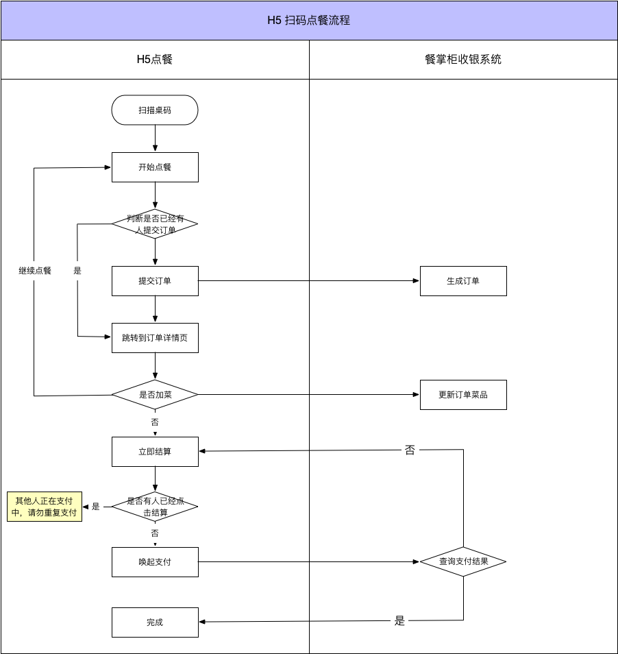
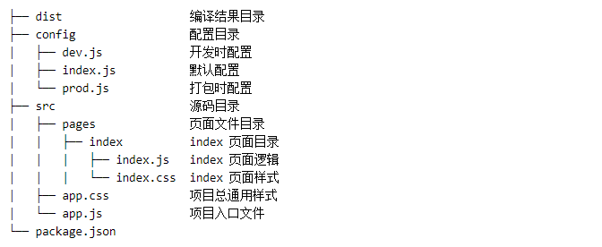

# 心飞餐饮微信端前端技术指导

## 1 微信端需求概述



### 1.1 点餐模式
心飞餐饮当前版本点餐模式为多人点餐，用户扫码后，对应的桌台状态会自动变更为“已开桌”，其他用户扫码后可与开台者共同点餐（共同将菜品加入购物车）。若开台者或其他用户已经提交订单，则其他人扫桌码后会自动跳转至订单详情页面，但是可选择“继续加菜”继续点餐。

### 1.2 结账模式
当前 心飞餐饮 的H5点餐为先付后吃的模式，该模式下用户需要预先支付所选择菜品后才会通知餐厅进行备餐，在该模式下，不存在加菜的情况，支付完成后如加菜需要重新进行下单即可。


## 2 技术选型

### 2.1 技术选型分析
Taro 立足于微信小程序开发，众所周知小程序的开发体验并不是非常友好，比如小程序中无法使用 npm 来进行第三方库的管理，无法使用一些比较新的 ES 规范等等，针对小程序端的开发弊端，Taro 具有以下的优秀特性

✅ 支持使用 npm/yarn 安装管理第三方依赖

✅ 支持使用 ES7/ES8 甚至更新的 ES 规范，一切都可自行配置

✅ 支持使用 CSS 预编译器，例如 Sass 等

✅ 支持使用 Redux 进行状态管理

✅ 支持使用 MobX 进行状态管理

✅ 小程序 API 优化，异步 API Promise 化等等

### 2.2 Taro 简介
Taro 是一套遵循 React 语法规范的 多端开发 解决方案。

现如今市面上端的形态多种多样，Web、React-Native、微信小程序等各种端大行其道，当业务要求同时在不同的端都要求有所表现的时候，针对不同的端去编写多套代码的成本显然非常高，这时候只编写一套代码就能够适配到多端的能力就显得极为需要。 

使用 Taro，我们可以只书写一套代码，再通过 Taro 的编译工具，将源代码分别编译出可以在不同端（微信 / 京东 / 百度 / 支付宝 / 字节跳动 小程序、快应用、H5、React-Native 等）运行的代码。


## 3 工程结构解析



## 4 核心代码解析

### 4.1 场景1开桌

```react
  /**
   * 选择就餐人数
   */
  changeSeatNumber(type) {
    let { seatNumber } = this.state
    if (type === 'add') {
      this.setState({ seatNumber: seatNumber + 1 })
    } else {
      if (seatNumber > 1) {
        this.setState({ seatNumber: seatNumber - 1 })
      }
    }
  }

  /**
   * 开桌
   */
  openCurrentTable() {
    const { tableId } = this.props.app.tableInfo
    let { seatNumber } = this.state

    this.props.dispatchOpenTable({ url: `table/open/${tableId}/${seatNumber}` }).then(res => {
      if (!res) {
        Taro.showToast({
          title: '开桌失败',
          icon: 'none',
          duration: 2000
        })
      }
      else {
        this.setState({ popup: false, opened: true })
      }
    })
  }
```


### 4.2 场景2多人点餐

```react
  /**
   * 获取菜品分类列表
   */
  componentDidMount(){
    this.props.dispatchMenuType({url: 'dish/category'}).then(res => {
      let category = res[0]
      this.getMenu(category.categoryId, category.type)
      this.setState({typeName: category.name})
    })
  }

  /**
   * 获取菜品列表
   */
  getMenu (categoryId, type, page = 1, pageSize = 10) {
    this.props.dispatchMenu({url: `dish/dishPageList/${categoryId}/${type}/${page}/${pageSize}`})
  }

  /**
   * 加菜、减菜
   */
  changNum(action, item) {
    const { shopId, storeId, tableId } = this.props.app.tableInfo
    if (action === 'add') {
      let dish = {
        tableId: tableId,
        storeId: storeId,
        shopId: shopId,
        dishId: item.id,
        dishName: item.name,
        type: item.type,
        price: item.price,
        dishNumber: 1,
        flavorRemark: item.flavorRemark,
        imageUrl: item.imageUrl
      }
      this.props.dispatchCartAdd({ url: 'order/addDish', method: 'POST', params: dish })
    } else {
      this.props.dispatchCartAdd({ url: `order/decreaseDish/${tableId}/${item.id}` })
    }
  }

  /**
   * 清空购物车
   */
  cleanCart() {
    const { tableId } = this.props.app.tableInfo
    this.props.dispatchCartClean({ url: `order/cleanShopCart/${tableId}` }).then(res => {
      if (!res) {
        Taro.showToast({
          title: '清空购物车失败',
          icon: 'none',
          duration: 2000
        })
      } else {
        this.cartsHandle()
      }
    })
  }
```


```react
import Taro from '@tarojs/taro'
import { Stomp } from './stomp'
import { getCartList } from './../actions/menu'

  /**
   * WebSocket和Stomp协议连接RabbitMQ
   */
export default function initWebScoket(tableId) {
    var socketOpen = false
    var socketMsgQueue = []
    function sendSocketMessage(msg) {
      console.log('send msg:')
      console.log(msg)
      if (socketOpen) {
        Taro.sendSocketMessage({
          data: msg
        })
      } else {
        socketMsgQueue.push(msg)
      }
    }

    var ws = {
      send: sendSocketMessage,
      onopen: null,
      onmessage: null
    }

    Taro.connectSocket({
      url: 'wss://socket-canzg.itheima.net/ws'
    });
    Taro.onSocketOpen(res => {
      console.log('WebSocket连接已打开！')

      socketOpen = true
      for (var i = 0; i < socketMsgQueue.length; i++) {
        sendSocketMessage(socketMsgQueue[i])
      }
      socketMsgQueue = []

      ws.onopen && ws.onopen()
    })

    Taro.onSocketMessage(res => {
      console.log('收到onmessage事件:', res)
      ws.onmessage && ws.onmessage(res)
    })

    Taro.onSocketClose(res => {
      console.log('收到onclose事件:', res)
    })

    Taro.onSocketError(res => {
      console.log('收到onerror事件:', res)
    })

    var client = Stomp.over(ws)

    var destination = `/exchange/micro_app_exchange/${tableId}`
    client.connect('guest', 'guest', sessionId => {
      console.log('sessionId', sessionId)

      client.subscribe(destination, (body, headers) => {
        console.log('From MQ:', body)

        Taro.$store.dispatch(getCartList(JSON.parse(body.body)))
      })
    })
  }
```

### 4.3 场景3提交订单

```react
  /**
   * 提交订单、微信支付
   */
  orderPay () {
    const { tableId } = this.props.app.tableInfo

    // 调用接口获取登录凭证（code）
    Taro.login({
      success: (loginRes) => {
        console.log(loginRes.code)

        if (!loginRes.code) {
          Taro.showToast({
            title: '登录失败',
            icon: 'none',
            duration: 2000
          })
          console.log('登录失败！' + loginRes.errMsg)

          return
        }

        // 支付下单
        this.props.dispatchOrderPay({url: `order/pay/${tableId}/${loginRes.code}`}).then(prepayRes => {
          console.log(prepayRes)
          if (!prepayRes) {
            Taro.showToast({
              title: '该桌有人正在支付',
              icon: 'none',
              duration: 2000
            })
            return
          }
          let temp = JSON.parse(prepayRes)

          // 发起微信支付
          Taro.requestPayment({
            timeStamp: temp.timeStamp,
            nonceStr: temp.nonceStr,
            package: temp.package,
            signType: 'MD5',
            paySign: temp.paySign,
            success: (res) => {
              console.log('支付成功')
              console.log(res)

              Taro.navigateTo({url: '/pages/order/success'})
            },
            fail: (res) => {
              console.log('支付失败')
              console.log(res)
              if (res.errMsg === 'requestPayment:fail cancel') {
                this.props.dispatchOrderPay({ url: `order/cancelPay/${tableId}` }).then(() => {
                  Taro.showToast({
                    title: '您已取消支付',
                    icon: 'none',
                    duration: 2000
                  })
                })
              }
            }
          })
        })
      },
      fail: (loginRes) => {
        console.log('登录失败！' + loginRes.errMsg)
      }
    })
  }
```


## 5 部署运行指南  

### 5.1 Node 安装
Taro 项目基于 node，请确保已具备较新的 node 环境（>=8.0.0）

### 5.2 CLI 工具安装
```
cnpm install -g @tarojs/cli@2.1.1
```

### 5.3 使用 cnpm 安装依赖

```
cnpm install
```

### 5.4 运行

```
npm run dev:weapp
```

### 5.5 打包

```
npm run build:weapp
```

